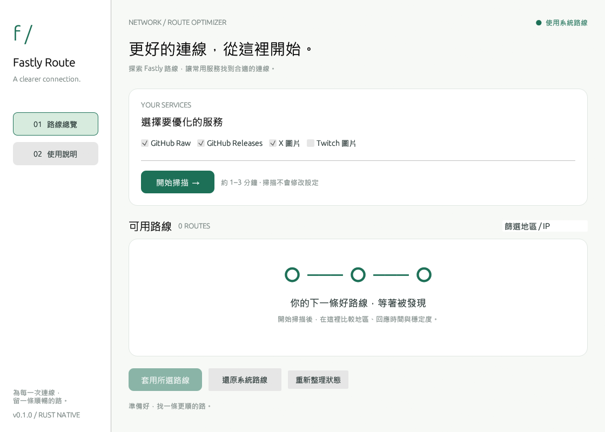

# Fastly Route

一個以 Rust 打造的極簡 Fastly CDN 路線工具。繁體中文原生桌面介面，奶白與深綠配色，不需要瀏覽器或 Node.js。



## 功能

- 即時取得 Fastly 官方 IPv4 網段，並行掃描 TCP 443。
- 各服務取附近延遲最低的 48 條候選，使用正確網域、SNI 與 TLS 憑證驗證，進行三輪 HTTPS 回應測試。
- 顯示節點地區（伺服器有提供時）、回應中位數、最大與最小差值、成功次數。
- 各服務自動選取三輪皆成功且回應最快的路線，也可手動選擇與篩選。
- 套用前再次驗證官方網段及 HTTPS；預覽後才寫入 hosts。
- 逐次備份、檔案鎖、保留原始位元組與檔案 ACL；拒絕既有網域衝突與破損標記。
- 還原只移除 Fastly Route 自己的區塊。無遙測、無背景常駐服務。

## Windows 使用

執行 `fastly-route.exe` → 勾選服務 → **開始掃描** → 選路線 → **套用所選路線**。

掃描不需要管理員權限。要套用或還原時，請先關閉程式，再右鍵選擇「以系統管理員身分執行」並重新掃描。變更後可能需要重新開啟瀏覽器，讓既有連線與 DNS 快取失效。

每次變更前會在 hosts 同一目錄建立 `hosts.fastly-route-<時間戳記>.bak`。還原不會刪除備份。若寫入發生 I/O 錯誤會嘗試回復原內容，斷電等中斷仍可使用備份手動復原。

## 第一版範圍

| 服務 | 實際涵蓋 |
| --- | --- |
| GitHub Raw | `raw.githubusercontent.com` |
| GitHub Releases | `release-assets.githubusercontent.com`，僅 TLS 與根路徑 404 驗證 |
| X 圖片 | `pbs.twimg.com` |
| Twitch 圖片 | `static-cdn.jtvnw.net`，不含網頁、直播影片、聊天室 |

這一版測量的是**收到 HTTPS 回應標頭的延遲與三輪成功率**，不代表下載頻寬、封包遺失率或長期穩定度，也不保證比系統預設更快。掃描限制為 32 條並行連線；只驗證每個服務附近的前 48 條候選，並非全球完整搜尋。所有測試直接連線，不使用系統 HTTP 代理。VPN 仍可能影響路由。

尚未實作原參考專案的多輪大檔下載測速、自訂網域、掃描快取、更新器與完整 Twitch 支援。掃描結果不會跨重啟保存。切換網路後建議還原並重測。Linux/macOS 程式碼路徑已預留，但目前只驗證 Windows。

## 開發

需要 Rust 1.92+ 與 Windows MSVC Build Tools。

```powershell
cargo run
cargo test --locked
cargo clippy --locked --all-targets -- -D warnings
cargo build --release --locked
```

產物：`target/release/fastly-route.exe`。測試只操作暫存檔，不讀寫系統 hosts。

```powershell
# 連線煙霧測試，不修改 hosts
cargo run -- --smoke-test
# 產生真實 UI 截圖後自動結束
$env:EFRAME_SCREENSHOT_TO = 'docs/preview.png'
cargo run --features screenshot
Remove-Item Env:EFRAME_SCREENSHOT_TO
```

GitHub Actions 執行格式、Clippy、測試與 Windows release build，並提供 exe artifact。

## 設計與授權

Rust + egui/eframe 原生介面；reqwest/rustls 網路驗證；Rayon 限制掃描併發。

靈感、服務 IP 尾碼及探測端點來自 [AFAlimru/fastly-hosts-adjust](https://github.com/AFAlimru/fastly-hosts-adjust)。此專案是獨立 Rust 實作，保留 [上游 MIT 授權](docs/UPSTREAM-LICENSE)。本專案採 MIT 授權，與 Fastly、GitHub、X 或 Twitch 無官方隸屬關係。
