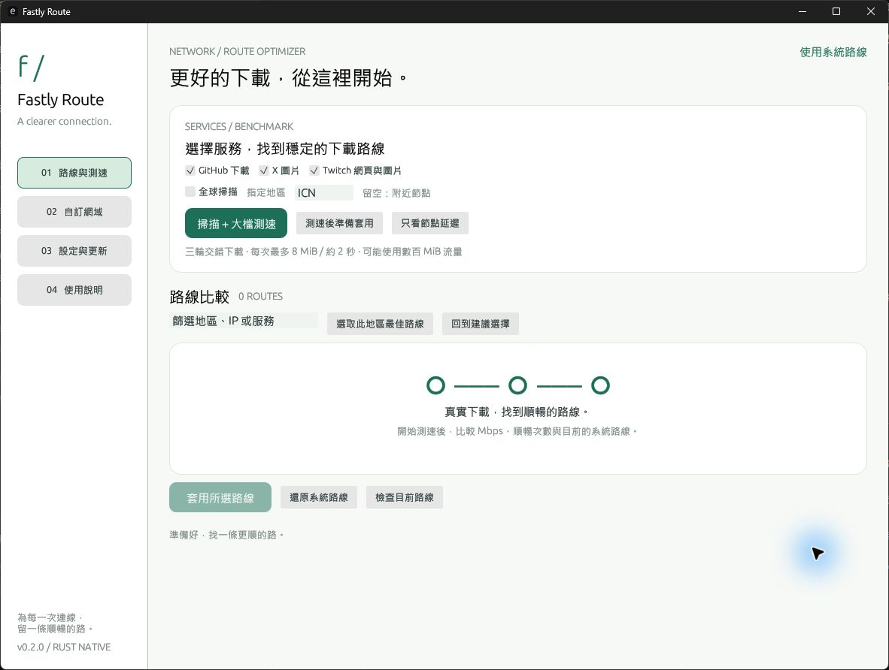

# Fastly Route

以 Rust + egui 打造的 Fastly 路線工具：原生桌面、繁體中文、極簡介面，Windows 啟動與背景操作不顯示 CMD 視窗。



## 下載與開始

在 [Releases](https://github.com/cycleapple/fastly-route/releases) 下載 Windows x64 壓縮包，解壓後執行 `fastly-route.exe`。也可下載獨立 exe。repo 已公開，下載與自動更新不需要登入 GitHub。

1. 勾選 GitHub、X、Twitch、Steam 商店或自訂服務。舊版使用者升級後需自行勾選新增的 Steam 商店，既有服務選擇保持不變。
2. 按「掃描＋大檔測速」，或用「只看節點延遲」快速查找。
3. 比較路線、選取需要變更的服務，按「套用所選路線」。
4. 確認預覽後會重新驗證、備份並寫入 hosts。切換網路或要回到預設時按「還原系統路線」。

掃描不需要管理員權限。套用、還原、清除系統設定需要管理員權限，可在「設定與更新」按「以管理員身分重新啟動」，由 Windows 顯示 UAC。程式不會繞過權限檢查。

## 測速與選路

- 從 Fastly 官方清單取得 IPv4 網段，以 32 條並行 TCP 443 連線掃描附近路線，再以正確 Host、SNI 與 TLS 憑證驗證。
- 附近最快 10 條候選（指定地區時最多 8 條）加上系統 DNS 現行路線，**交錯下載三輪**。每輪更換起始順序，避免某條路線固定先測；下載採逐條進行，不讓候選互搶頻寬。
- GitHub 使用最新大型 Release 的簽章下載 URL；每輪重新取得。Twitch 從首頁動態取得網頁 JS 檔。
- 每次最多下載 **8 MiB**，取樣約 **2 秒**；單次 HTTPS 請求最長 5 秒。只讀進記憶體，不將測速檔存到磁碟。整次測試可能使用數百 MiB 流量。
- **順暢**定義：至少 3 Mbps，且達該服務本次最高單次速度的 30%。排序依序為有完整測速資料、順暢次數、速度中位數、延遲。
- 系統路線同樣順暢時，不會建議變更。沒有可用測速檔時會明確標示「未測速」，以延遲作為後備。
- X 圖片太小，不將圖片速度誤報為頻寬。只借用同 /24 且實測 POP 相同的 GitHub 路線數據，顯示為「同 POP 代理」。不符合時保留延遲結果。
- 測量值受當時網路、VPN、遠端檔案與服務影響，不能保證長期速度。掃描與測速直接連線，不經 HTTP 代理。

## 服務與自訂網域

| 服務 | hosts 涵蓋 |
| --- | --- |
| GitHub | `raw.githubusercontent.com`、`release-assets.githubusercontent.com` |
| X 圖片 | `pbs.twimg.com` |
| Twitch | `www.twitch.tv`、`gql.twitch.tv`、`static-cdn.jtvnw.net`、`assets.twitch.tv`、`k.twitchcdn.net` |
| Steam 商店 | `store.fastly.steamstatic.com`、`cdn.fastly.steamstatic.com`、`shared.fastly.steamstatic.com` |
| 自訂 | 通過驗證的 Fastly 網域 |

Steam 商店以官方約 1.3 MB 圖片做三輪實際下載取樣，顯示速度中位數與穩定度；此數值是該圖片的傳輸速度，不代表整頁載入時間或線路最大頻寬。套用時驗證並一起寫入上述三個 Fastly 網域，不包含 `store.steampowered.com`、登入、Akamai 資源或遊戲下載。可使用「測速後準備套用」完成掃描並開啟確認預覽，再一次套用全部三個網域。

Twitch 只處理網頁、圖片、API 與表情符號，**不包含直播影片與聊天室**。

在「自訂網域」輸入例如 `files.pythonhosted.org`。程式會檢查 DNS IPv4 是否位於 Fastly 官方網段、推算最常用的尾碼並驗證 HTTPS。可選填同網域的 HTTPS 測速檔（至少 256 KiB）。不可指定其他網域、非 443 連接埠、含帳密或 fragment 的網址。測速 URL 保存在本機設定中。

可移除自訂服務。已套用的 hosts 區塊在下次套用或還原時更新，移除清單項目本身不直接修改系統 hosts。

## 地區、快取與資料

- 「全球掃描」列出所有可連線節點；指定 `ICN`、`NRT`、`HKG` 等三碼會搜尋該地區，並保留系統路線供比較。
- 可依地區、IP、服務篩選，或「選取此地區最佳路線」。結果保存在 `scan.json`，重啟可直接選擇。
- 快取不是免驗證通行證：套用前再次驗證官方網段、HTTPS 憑證、每個目標網域與 POP 是否改變。
- 設定與快取位於 `%LOCALAPPDATA%\FastlyRoute\data`（以設定頁顯示路徑為準）。不傳送遙測。
- hosts 每次修改前建立 `hosts.fastly-route-<時間戳記>.bak`。保留既有註解、編碼、換行及 ACL，拒絕衝突網域與破損區塊；使用檔案鎖，I/O 錯誤時嘗試回復。
- 「還原並清除設定與快取」先還原 hosts，再清除本工具的 JSON 資料。備份檔與舊版 exe 會保留供手動復原，不做廣泛刪除。

## 自動更新與無 CMD

啟動時自動檢查 GitHub Releases，可在設定關閉或允許預覽版。發現新版後按「下載並安裝更新」，程式會：

1. 使用 SemVer 比較版本，排除舊版本、草稿與未啟用的預覽版。
2. 下載 `fastly-route.exe` 與 `SHA256SUMS.txt`，限制檔案大小與重導向來源。
3. 比對 SHA-256（以及 GitHub 有提供時的資產 digest），並確認是 Windows x64 GUI 執行檔。
4. 備份目前 exe，替換失敗則嘗試回復；成功後按「重新啟動」生效。

私人 repo 使用 `GH_TOKEN` / `GITHUB_TOKEN` 或已登入的 GitHub CLI (`gh auth login`)。程式不儲存權杖，也不會把它轉送至下載 CDN。沒有權限時會顯示原因。公開 repo 則可匿名查詢。

**v0.1.0 沒有內建更新器，第一次需要手動下載 v0.2.0。之後可以在程式內更新。** 更新檢查自動執行，下載與替換由使用者確認，不會在背景強制重啟。

Windows debug 與 release 都使用 GUI subsystem。背景 GitHub CLI、PowerShell 管理員啟動、DNS 清除及重啟均使用 `CREATE_NO_WINDOW`；不使用批次檔更新器。UAC 是 Windows 權限視窗，不是 CMD。

## 開發與驗證

Rust 1.92+、Windows MSVC Build Tools：

```powershell
cargo run
cargo fmt --check
cargo clippy --locked --all-targets -- -D warnings
cargo test --locked
cargo build --release --locked
```

產物：`target/release/fastly-route.exe`。一般自動測試只操作暫存檔，不修改系統 hosts，也不連網路。

```powershell
# 明確啟用實際連網、下載測試（完整掃描可能用數百 MiB）
cargo test live_network_downloads_and_custom -- --ignored --nocapture
cargo test live_full_scan -- --ignored --nocapture
cargo test live_update_check -- --ignored --nocapture

# 隔離手動 UI 測試資料
$env:FASTLY_ROUTE_DATA_DIR = 'E:\FastlyTool\target\ui-test-data'
cargo run

# 產生真實 UI 截圖後結束
$env:EFRAME_SCREENSHOT_TO = 'docs/preview.png'
cargo run --features screenshot
Remove-Item Env:EFRAME_SCREENSHOT_TO
```

Windows 為主要支援與實測平台；Linux/macOS 沿用原生 UI 與 hosts 路徑，但自動安裝更新目前只支援 Windows x64。

## 發佈與差異

GitHub Actions 檢查格式、Clippy、測試、release build。推送 `v*` tag 時，發佈 workflow 會產生 exe、zip、SHA256SUMS，提供更新器需要的資產。Cargo 版本必須與 tag 一致。

目前與原專案主要差異：原生繁體中文 GUI、IPv4 掃描；不提供英文切換或完整 CLI 指令集；清除資料時保留可復原的備份。核心掃描、三輪測速、地區切換、服務選擇、自訂網域、快取、還原及更新已涵蓋。

靈感、服務尾碼、探測端點與選路方式來自 [AFAlimru/fastly-hosts-adjust](https://github.com/AFAlimru/fastly-hosts-adjust)，保留 [上游 MIT 授權](docs/UPSTREAM-LICENSE)。本專案採 MIT 授權，與 Fastly、GitHub、X、Twitch 無官方隸屬關係。
